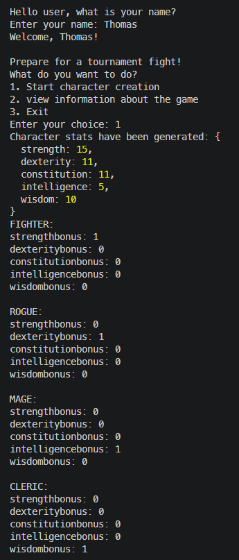
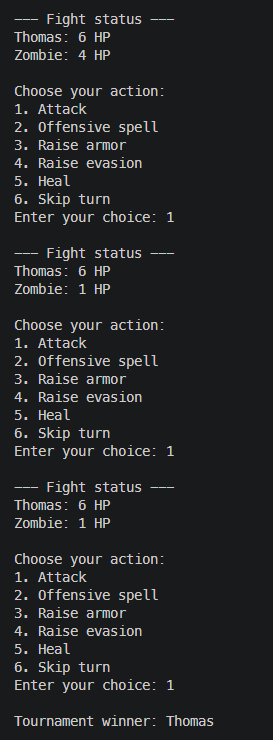

# RPG Random Game

RPG Random Game is a terminal game written in TypeScript. Create a character, enter a single elimination tournament, and fight randomly generated enemies. Every tournament match is a one-on-one fight handled by the V_02 version of the DnD combat module.

## Requirements

- Node.js 24.12.0 or later
- npm

## Install and run

```bash
npm install
npm start
```

The application asks for your name and then shows the main menu. Choose **1** to create a character and start a tournament.

## Playing the game

1. Choose a character class and race.
2. The game rolls three six-sided dice for each stat: Strength, Dexterity, Constitution, Intelligence, and Wisdom. The chosen class and race add their bonuses to the rolls.
3. Choose a positive odd number of enemies. Each enemy is randomly selected from the available enemy definitions.
4. Your character and the enemies enter a single elimination tournament.
5. Each match is one-on-one. The player chooses actions on their turn; enemies act automatically.
6. The fight returns its winner to the tournament scheduler. The winner advances until the final produces a tournament champion.

The player can choose to attack, cast an offensive spell, raise armor, raise evasion, heal, or skip a turn. In a one-on-one match, attacks target the opponent and healing targets the acting character.

Character state carries between tournament matches. Winners keep their remaining HP and any armor or evasion increases gained in earlier fights. Starting another tournament from the menu resets the previous roster.

## Tournament size and byes

The game currently asks for an odd number of enemies. With one player, that creates an even total number of participants. However, an even number alone does not guarantee that every participant fights in every round. For example, six participants do not fit evenly into a single elimination bracket all the way to the final, so the scheduler advances some participants without a match in an early round. This is called a **bye**; it is not an elimination.

To have no byes in a single elimination bracket, the total number of participants must be a power of two: 2, 4, 8, 16, and so on. With one player, that means 1, 3, 7, or 15 enemies. The current input accepts any positive odd enemy count, so a bye can still happen for some choices.

## How the modules work together

The RPG characters and the scheduler use different objects for different jobs:

- `Player` and `Enemy` inherit from `Character`. These objects hold the character's stats and changing combat state, such as current HP, armor, and evasion.
- The tournament scheduler works with `Participant` objects. It creates rounds and matches but does not run combat.
- `tournamentAdapter.ts` creates one scheduler participant per character and keeps a map back to the original character object.
- The DnD fight module receives the two characters for a match, runs combat, and returns the winning character.
- The app records that character as the match winner. The scheduler then uses the result to create the next round.

The key handoff in `playTheGame` looks like this:

```ts
const homeCharacter = roster.characterByParticipant.get(homeParticipant)
const awayCharacter = roster.characterByParticipant.get(awayParticipant)

const fight = new FightEncounterHandler<Character, Character>(
  [firstFighter],
  [secondFighter]
)
const winner = fight.goThroughFullFight(choosingOptionDuringFight())

if (winner === homeCharacter) {
  match.recordResult(1, 0)
} else if (winner === awayCharacter) {
  match.recordResult(0, 1)
}
```

The scheduler only needs to know which participant won, so the app records a simple `1–0` or `0–1` result. The fight module is responsible for combat rules and the winner; the tournament scheduler is responsible for who advances.

## Main menu

- **1. Start character creation** — create a character and run a tournament.
- **2. View information about the game** — show a short description of the game and stats.
- **3. Exit** — close the application.

## Project structure

```text
src/
├── app.ts                                      # CLI menus, tournament rounds, and fights
├── tournamentAdapter.ts                       # Maps scheduler participants to RPG characters
├── tournament-scheduler.d.ts                  # TypeScript declarations for the scheduler package
└── game/
    ├── Game.ts                                # Stores and resets players, enemies, and participants
    └── character/tournamentRpgCharacter/
        ├── Character.ts                       # Shared stats, HP, and combat state
        ├── Player.ts                          # Player character and class/race bonuses
        ├── Enemy.ts                           # Enemy character
        ├── Race.ts                            # Race bonuses
        ├── characterClasses.ts                # Class bonuses
        └── enemies.ts                         # Enemy definitions
```

## Screenshots

### Start of app

When startining the game you will enter your name, stats will be rolled and the oprion for different classes will be offered.



### End of tournament

During the fight multiple options of what to do next will be represented to the user.
After the fight(s) a winner is decleared.



## Dependencies

- [rpg-fight-encounter](https://github.com/MrNegnar/DnDModule) — runs V_02 combat and returns the fight winner.
- [tournament-scheduler](https://github.com/nordstrom-a/tournament-scheduler) — creates the single elimination bracket, records match results, and advances winners.
- [readline-sync](https://www.npmjs.com/package/readline-sync) — reads menu choices in the terminal.

## Development commands

```bash
npm run typecheck    # Check TypeScript types without producing files
npm run test:run     # Run tests once
npm test             # Run Vitest in watch mode
npm run build        # Build the application into dist/
npm run lint         # Check source files with ESLint
npm run format:check # Check formatting with Prettier
```

Vitest is configured for the project. The RPG app's test suite is currently being developed.

## Author

Created by:
Thomas Landin
Second year student at Linnaeus University, Kalmar.

## License

This project is released under the Unlicense. See [LICENSE](LICENSE) for details.
